# Hi, I'm Brender Odoyo 👋

### Backend Software Developer | Go

Software Development Apprentice at **Zone01 Kisumu**.

I build backend services, REST APIs, and database-driven applications. I enjoy solving problems, learning new technologies, and contributing to open-source projects.

  
  

---

## About Me

- Backend-focused developer working primarily with **Go**.
- Building REST APIs and database-backed applications.
- Interested in software architecture, testing, and open-source development.
- Currently growing my skills through collaborative software development at Zone01 Kisumu.

---

## Tech Stack

  

---

## 📊 GitHub Statistics

  

  

---

---

## 🏆 GitHub Trophies

  

---

## 🔥 Contribution Streak

  

